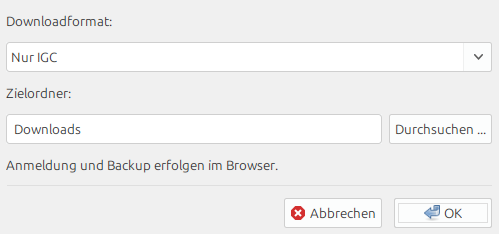
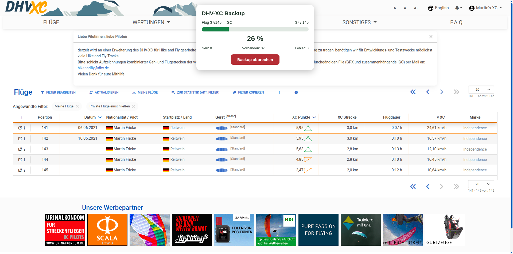
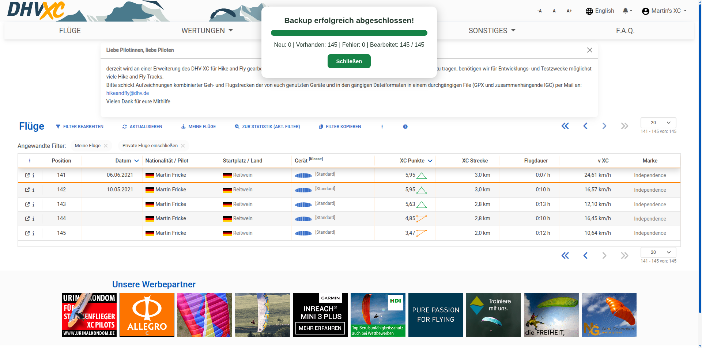

# DHV-XC Backup

**DHV-XC Backup** sichert deine Flüge von [DHV-XC](https://de.dhv-xc.de) als **IGC** oder **KML**. Bereits vorhandene, gültige Dateien werden übersprungen.







## Voraussetzungen

- Java 8 oder neuer
- Internetverbindung und DHV-XC-Konto
- Unterstütztes Betriebssystem mit den für Chromium erforderlichen Bibliotheken

Chromium wird bei Bedarf beim ersten Start installiert.

## Starten

Die fertige **`dhv-xc-backup.jar`** herunterladen und mit Java öffnen oder im Terminal starten:

```bash
java -jar dhv-xc-backup.jar
```

Im Startdialog Format und Zielordner wählen. Dann im Browser anmelden, den Filter **„Meine Flüge“** auswählen und **„Backup starten“** anklicken. Mit **„Backup abbrechen“** wird nach dem laufenden Download kontrolliert beendet. Die Anmeldung kann für den nächsten Start gespeichert werden.

## Selbst bauen

Benötigt: JDK und Maven.

```bash
mvn clean package
java -jar target/dhv-xc-backup.jar
```

Der Build verwendet **Java 8** als Zielversion und **Playwright 1.64.0**.

Die Einstellungen, Anmeldung und das Protokoll liegen unter `~/.dhv-xc-backup/`. Die Sitzungsdatei **nicht veröffentlichen**.

*Unabhängiges Projekt, nicht offiziell vom DHV betrieben.*